<p align="center">
  
</p>

<p align="center">
  <a href="https://erkamaydin.com"></a>
  <a href="https://www.linkedin.com/in/erkam-ayd%C4%B1n-bb6500218/"></a>
  <a href="https://www.instagram.com/erkamyigitaydnn/"></a>
</p>

I build web products for a living and native Mac and iPhone apps for fun.
Lately that means making the MacBook notch actually useful, 3D tools that run in a browser tab, and small puzzle games.

## 💧 Damla

<p align="center">
  <a href="https://erkamyigitaydin.github.io/Damla/">
    
  </a>
</p>

**Your notch, finally doing something.**
Hover over the notch and a Liquid Glass panel melts out: now playing, sound, files, clipboard, focus, and approvals from your AI coding agents.
No account, no server, no tracking. Signed, notarized and self-updating.

```sh
brew install --cask erkamyigitaydin/tap/damla
```

<p>
  <a href="https://github.com/erkamyigitaydin/Damla/releases/latest"></a>
  <a href="https://erkamyigitaydin.github.io/Damla/"></a>
</p>

## 🧪 On the workbench

| | Project | What it is |
|:-:|---|---|
| 🎾 | **Racketlab** | A 3D racket design studio in the browser. React + Three.js |
| 🧩 | **Denge** | A 6×6 Takuzu logic puzzle for iPhone. SwiftUI |
| 🏝️ | **Living Island** | A local-first ecosystem game with a seeded simulation. TypeScript |

## ⚡ Live

<!-- LIVE:START -->
| | |
|---|---|
| 💧 **Damla** | [v0.8.11](https://github.com/erkamyigitaydin/Damla/releases/tag/v0.8.11) shipped 2 weeks ago |
| 📈 **Last 30 days** | **136** contributions across **17** days |
| 🔥 **Best streak** | **16** days in a row this year |
| 📅 **Busiest day** | Thursday |
<!-- LIVE:END -->

## 🛠 Toolbox

<p>
  
</p>

## 🐍 A year of commits

<picture>
  <source media="(prefers-color-scheme: dark)" srcset="https://raw.githubusercontent.com/erkamyigitaydin/erkamyigitaydin/output/snake-dark.svg">
  <source media="(prefers-color-scheme: light)" srcset="https://raw.githubusercontent.com/erkamyigitaydin/erkamyigitaydin/output/snake.svg">
  
</picture>

<p align="right"><sub>This page updates itself with GitHub Actions.</sub></p>
